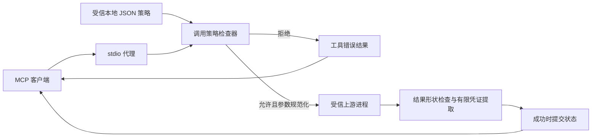

# 架构与策略

0.2 将调用前的权限检查、调用后的结果记录和实际工具执行分开。安全判断依赖受信本地策略，不从用户目标、上游工具名称或工具描述推断权限。



图中的路径和网络检查作用于代理可见的调用参数。上游运行在普通宿主权限下，进程自身的系统调用不经过本库拦截。

## 本地策略

策略文件是 UTF-8 JSON，`version` 当前为 `1`。工具权限由维护者根据上游实际行为配置；代理不会自动验证声明与工具实现是否一致。一个工具有多种能力时应全部登记，例如会读取本地文件并上传的工具同时具有 `read` 和 `network` 能力。

示例：

```json
{
  "version": 1,
  "workspace": "workspace",
  "tools": {
    "read_file": {
      "capabilities": ["read"],
      "parameters": {"path": "string"},
      "path_fields": ["path"],
      "roots": ["."],
      "output_untrusted": true
    },
    "write_file": {
      "capabilities": ["write"],
      "parameters": {"path": "string", "content": "string"},
      "path_fields": ["path"],
      "roots": ["."]
    },
    "python_version": {
      "capabilities": ["execute"],
      "parameters": {},
      "allowed_arguments": [{}],
      "output_untrusted": false
    }
  }
}
```

`workspace` 相对策略文件所在目录解析，必须是现有目录；`roots` 相对工作区解析，必须是工作区内的现有目录。应将策略、代理和上游程序保存在工具不可写的位置。单次会话使用加载后的策略，不热加载磁盘变化；这不能保护下次启动时读取的策略文件。

| 字段 | 含义与限制 |
| --- | --- |
| `capabilities` | 非空列表，可组合 `read`、`write`、`network`、`execute`、`compute` |
| `parameters` | 参数名到顶层类型的映射，支持 string、integer、number、boolean、object、array；并非完整 JSON Schema |
| `required` | 必填字段，默认所有已定义参数；未定义的额外参数始终拒绝 |
| `path_fields`、`roots` | 文件读写能力必须配置。路径字段须为必填字符串；拒绝穿越、若干歧义路径及根目录之外的解析结果，向上游传递规范化绝对路径 |
| `url_fields`、`origins` | 网络能力必须配置。URL 字段须为必填字符串；origin 精确比较协议、规范化主机名和端口，不使用子字符串匹配 |
| `allowed_arguments` | 执行能力必须配置完整参数对象白名单；匹配发生于路径规范化之前。它不验证上游实际执行的系统命令 |
| `output_untrusted` | 结果来源标记，默认 true；false 也不会关闭凭证识别 |
| `sensitive_fields` | 对当前工具结果补充敏感字段名，字段值须为非空字符串才会提取 |
| `state` | 工具成功后提交的状态名，默认工具名，不能是保留的 START |
| `transitions` | 顶层可选状态转移表。未配置或为空时不限制顺序；非空时，未登记的转移拒绝 |
| `max_bytes` | 参数、结果及输入通信帧上限，默认 262144 字节，最高 1048576；MCP 帧包含协议包装 |
| `max_secrets` | 会话凭证数量上限，默认 128，最高 4096 |
| `max_events` | 内存审计事件保留数量，默认 256，最高 4096；达到上限后覆盖最旧事件 |

网络 origin 示例为 `https://example.invalid`。允许该 origin 不意味着禁止它跳转到其他主机，也不验证其最终解析 IP。维护者必须在受信上游或宿主网络层实现所需的跳转、DNS 和出站限制。

状态表例如 `{"START":["read_file"],"read_file":["write_file"]}` 只允许先成功读取，再写入；写入之后没有登记的后继调用会被拒绝。它是显式顺序约束，不是用户意图识别。

## 凭证记录与来源标记

`TaintTag` 的 `untrusted` 与 `sensitive` 是独立布尔值，敏感结果不会覆盖来源标记。当前实现不记录任意字节的跨函数传播，也不推断模型的推理依赖。

工具结果可通过以下方式产生已知凭证：

- JSON 对象内的内置敏感字段或当前工具配置的 `sensitive_fields`。
- 文本中有限的赋值模式和令牌前缀。
- 作为文本返回、能够完整解析为对象或数组的 JSON 文档中的上述字段。

对于 `network`、`write`、`execute` 工具，检查器扫描所有参数中的字符串，并尝试最多两次百分号解码；它比较已知凭证明文、标准和 URL-safe Base64（含去填充形式）、大小写十六进制。没有来源记录时，参数中的已识别凭证模式也会触发拒绝。整个对象的编码、分片、任意变换、非字符串秘密或未被识别的秘密不在保证范围内。

单条记录上限为 4096 UTF-8 字节，递归深度上限为 32。结果过大、嵌套过深或凭证容量耗尽时，会话保守关闭，不截断长凭证或逐出旧凭证后继续放行。此时上游操作可能已发生。正常通过跟踪的结果仍会返回客户端，不自动遮盖凭证；检测主要作用于后续工具参数。关闭会话清空内部凭证集合；这不构成可靠的内存擦除。

## 调用状态与 Python API

`check_call` 只返回决策，不预留调用或更新成功状态。`begin` 检查并预留一个在途调用；`complete` 处理对应结果，只有 `is_error=False` 才提交状态。`abort` 默认关闭会话。同步宿主通常使用 `execute`：

```python
from agent_immunity import DynamicImmunityEngine, Policy, ToolCall, ToolResult

policy = Policy.load("examples/policy.json")
engine = DynamicImmunityEngine(policy)

def handler(tool_name, arguments):
    # 在这里接入受信的真实工具实现；演示仅返回固定结果。
    if tool_name != "python_version":
        raise ValueError("示例处理器不支持该工具")
    return ToolResult({"message": "处理器接入示例"})

try:
    result = engine.execute(ToolCall("1", "python_version", {}), handler)
    print(result)
finally:
    engine.close()
```

上面是 API 连接示例，不是实际版本查询证据；真实副作用示例在 `examples/local_tools.py`。宿主必须只向处理器传递检查后返回的参数，并将真实结果交给 `complete`；不得在引擎之外执行同一调用。进程内不可信代码能绕开或修改对象，因此该 API 的宿主也必须受信。

默认关闭的情况包括处理器抛出异常、跟踪无法完成以及 MCP 通信结果不确定。有效的工具错误结果会被记录，但不提交成功状态，也不必关闭会话。错误消息不回显原调用参数；内存事件只保留登记工具名、状态码和成功标志，未知工具名以固定占位符记录。没有持久化或防篡改审计保证。

## 显式依赖 DAG 实验

`core/agent_runtime.py` 保留 `CausalActionDAG`，由调用方显式登记节点及已存在的父节点。剪枝只计算这些已声明依赖的后继关系。它不自动发现因果关系、不重写模型上下文，当前 MCP 代理也不使用它进行恢复。旧版 `AgentRuntime` 和预写的“自愈结果”不再属于当前实现。
